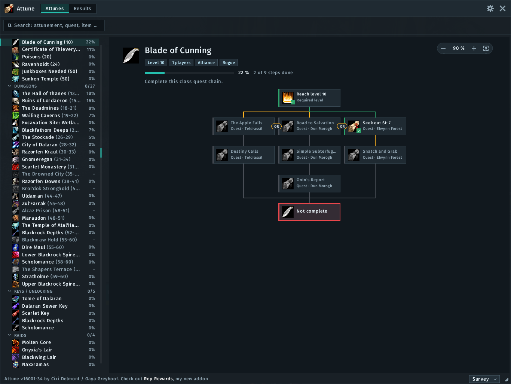
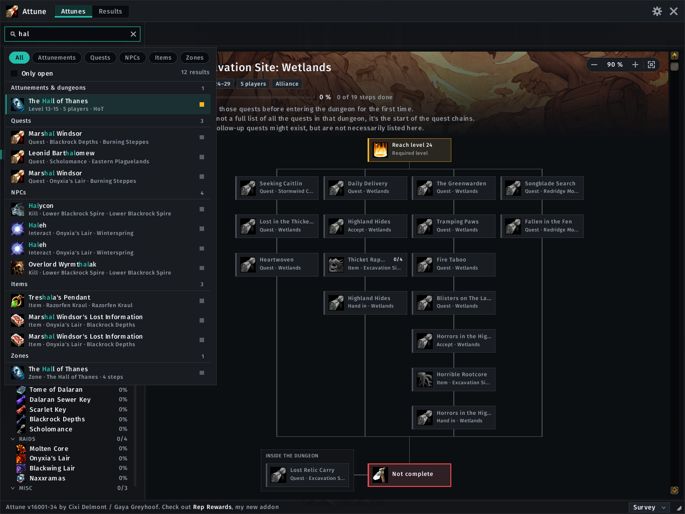
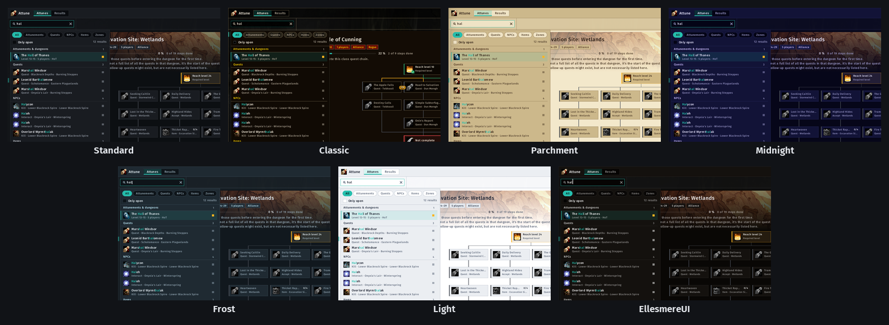
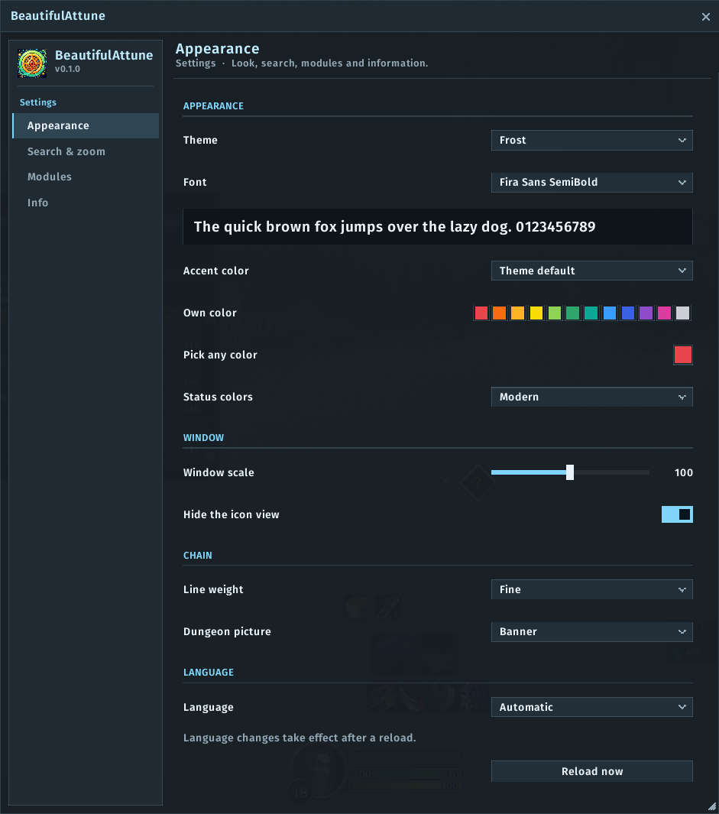
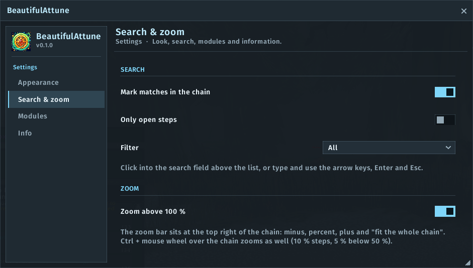
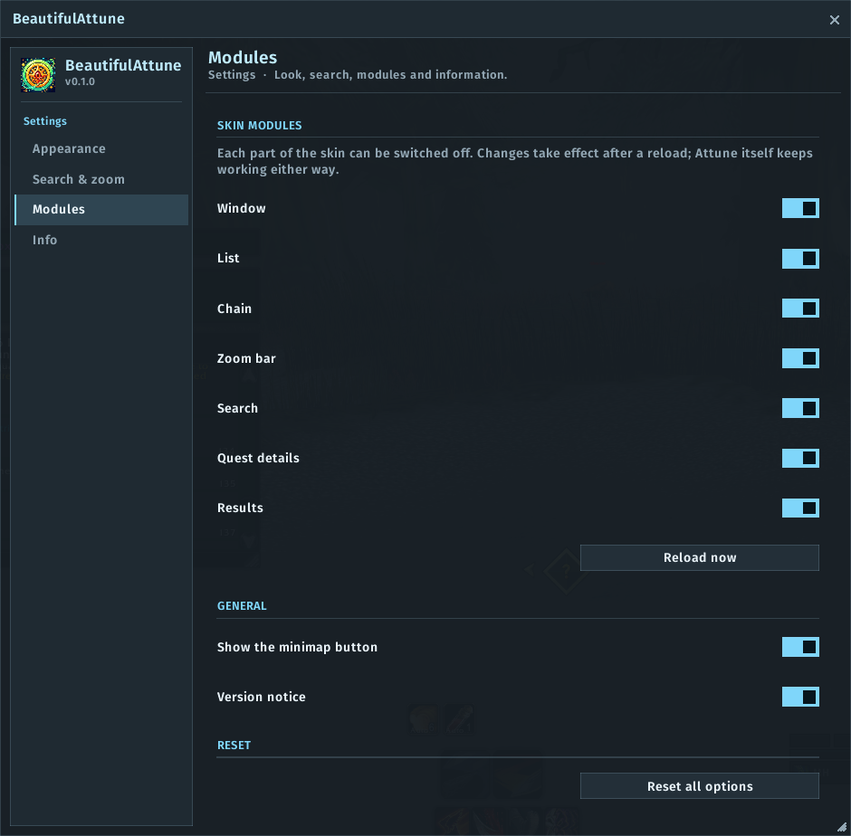

# BeautifulAttune

A modern, searchable look for the **Attune** addon on **World of Warcraft: Forever**.

BeautifulAttune restyles Attune's window while you play: a flat, clean frame, a tidy list, readable chain cards and crisp
connector lines. On top it adds a **search with filters** and a **zoom bar**. Attune keeps doing all the work: progress,
status, surveys and data stay exactly as they are. BeautifulAttune only changes how things look.

> Unofficial. Not affiliated with or endorsed by the authors of Attune or EllesmereUI. **Attune is required** and installed
> separately. EllesmereUI is optional. No code, graphics or texts from Attune or EllesmereUI are included.

## Features

- **Window** – a flat frame in the active theme with a compact header (switch between attunements and results, settings,
  close), status bar and survey menu in the same style. Move and resize it as before; scale it from 70 to 130 %.
- **List** – expansions and groups as section headings with a counter, attunements with icon, level range and your
  progress. Attune's icon grid is hidden so the list always looks the same (can be switched off).
- **Chains** – cards with a status strip and clear colours for done, ready and locked steps, highlighted keys, the end
  card and "OR" steps, connector lines without gaps at the corners, a head card with level range, group size, progress and
  the dungeon picture. Choose between a modern colour scheme and Attune's classic colours, and between fine, normal and
  strong lines.
- **Zoom** – a zoom bar on the chain from 10 to 150 %, "fit the whole chain", Ctrl + mouse wheel; remembered between
  sessions.
- **Search** – find attunements, quests, NPCs, items and zones while you type. Filter chips, "open steps only", ignores
  case and accents (German umlauts too), finds quest, NPC and item IDs and the usual short names. Use the arrow keys and
  Enter; the chain opens with the step centred and highlighted, and matching cards of the open chain are marked.
- **Quest details and results** – the quest detail panel with map and rewards, and the results table, in the same style.
- **Looks** – seven themes (Standard, Classic, Parchment, Midnight, Frost, Light and, with EllesmereUI, EllesmereUI),
  accent colour of the theme, of your class or of your choice, and bundled fonts (Inter, Fira Sans, Barlow) or the game
  font. With **EllesmereUI** the accent colour, font and language follow EllesmereUI, and the settings also appear in its
  options window ("Attune Skin").
- **Safe** – if a new Attune version changes something, only the affected part of the skin switches off; Attune stays
  fully usable and `/battune diag` shows what is missing. Each part of the skin can be switched off in the settings.
- **Languages** – English and German.

## Commands

| Command | Effect |
|---|---|
| `/battune` | settings (in EllesmereUI when it is installed) |
| `/battune options` | the BeautifulAttune settings window |
| `/battune eui` | the settings in EllesmereUI |
| `/battune attune` | open or close the Attune window |
| `/battune minimap` | show or hide the minimap button |
| `/battune diag` | versions, Attune parts and modules (for bug reports) |
| `/battune reset` | reset all settings (asks first) |

The minimap button and the entry in the addon compartment open Attune with a left-click and the settings with a
right-click.

## Install

Install it through CurseForge, or copy the `BeautifulAttune` folder into the `Interface\AddOns` folder of your
WoW: Forever installation (for the beta: `World of Warcraft\_classic_beta_\Interface\AddOns`). Attune must be installed
as well.

## Bug reports

Please open an issue with the full Lua error text, the output of `/battune diag` and your Attune version.

## License

MIT, see `LICENSE`. The bundled fonts are under the SIL Open Font License 1.1 (`Media/Fonts/OFL-*.txt`).
